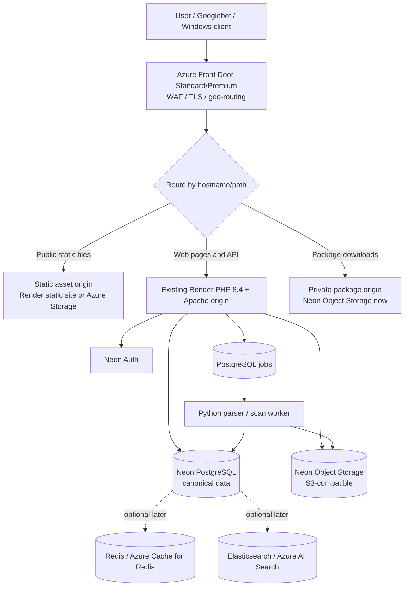

# Azure Front Door reference profile for HendyStore

> This is the alternative/failover design from the second submitted diagram, not the active production deployment.

## 1. Azure diagram mapped to current system

## 2. Do not duplicate the core backend

The second diagram includes a static host, Puppeteer/Node renderer, ASP.NET Core 8 BFF, Redis, Azure SQL and Azure Blob. Those services would form a second full backend stack. Running them beside the current PHP/Neon app without clear ownership boundaries would create two auth layers, two databases and inconsistent app/download state.

For an Azure edge pilot, use Azure Front Door as the single edge for the test hostname and route to the existing Render origin. Keep Neon as the only canonical database and storage source. Test cache bypass for `/api.php`, `/admin/`, auth callbacks, sessions and signed package grants.

If a full Azure application migration is later approved, migrate one bounded service at a time. The .NET 8 BFF can replace the PHP API only after contract tests cover every existing API action and session/role mapping. Azure SQL should not become a second writable copy; retain Neon as canonical or plan a formal database cutover with backup, reconciliation and rollback.

## 3. Azure Front Door security and cache checklist

- Prefer Front Door Standard/Premium for a new deployment. Microsoft states Front Door Classic retires on March 31, 2027.
- Attach a WAF policy; tune managed rules and custom rate limits after staging false-positive review.
- Restrict direct origin requests. When possible use Private Link; otherwise combine origin IP restrictions with `X-Azure-FDID` verification and an origin-only secret/header where supported.
- Configure health probes and a separate origin group for failover only after an independently healthy origin exists.
- Cache versioned public static assets only. Disable caching for authenticated APIs and personalized responses.
- Enable access, WAF and health-probe logs; redact credentials and personal data.
- Do not connect Front Door to a Cloudflare-proxied hostname in a routing loop or create Cloudflare → Front Door → Cloudflare.

## 4. Cost and operations gate

Azure Front Door, Azure Blob, Azure SQL, Redis and Elasticsearch are separate managed services with separate costs. No Azure resources were created by this PR. Create them only after a monthly budget, region, domain owner, incident owner and restore/failover procedure are approved.

## 5. Microsoft references

- [Azure Front Door security and Standard/Premium guidance](https://learn.microsoft.com/en-us/azure/frontdoor/secure-front-door)
- [Azure Front Door origin security and X-Azure-FDID](https://learn.microsoft.com/en-us/azure/frontdoor/origin-security)
- [Azure Front Door origin groups](https://learn.microsoft.com/en-us/azure/frontdoor/how-to-configure-origin)
- [Azure Front Door cache configuration](https://learn.microsoft.com/en-us/azure/frontdoor/how-to-configure-caching)
