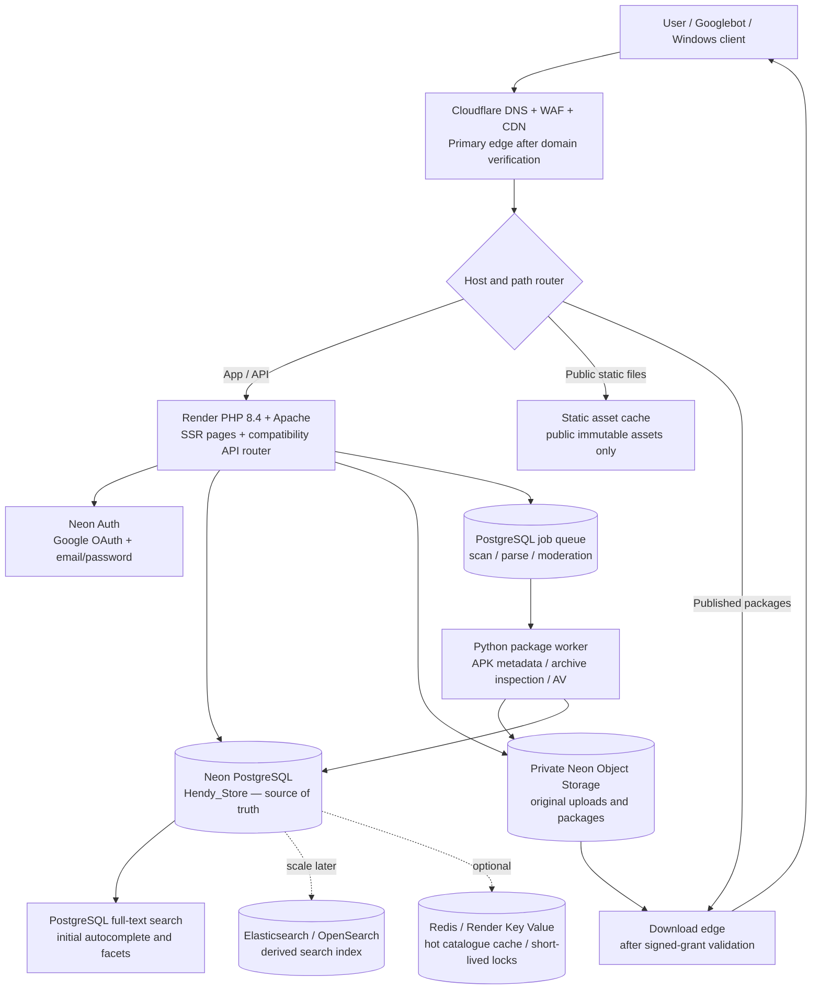
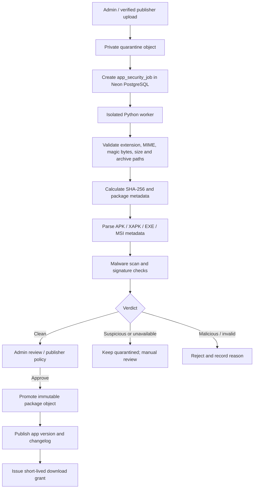

# HendyStore target architecture — unified Cloudflare + Render + Neon

> Architecture proposal in PR #3. These diagrams do not mean Cloudflare, Azure, Nginx, Elasticsearch, Redis or parser workers are deployed.

## 1. Architecture decision

The two supplied diagrams describe overlapping deployment profiles. They should be combined as one platform design, not deployed as two complete and competing stacks.

**Primary production path:** Cloudflare DNS/WAF/CDN (after domain configuration) → current Render PHP/Apache origin → Neon PostgreSQL + Neon Object Storage. Add background workers, search and cache services only when the workload and acceptance tests justify them.

**Azure path:** Azure Front Door is an alternative/failover edge. It can be tested against the same origin; do not chain Cloudflare and Azure Front Door by default. Do not create Azure SQL alongside Neon as a second authoritative database.

## 2. Verified runtime inventory

| Component | Verified status |
|---|---|
| Web origin | Render Web Service `HendyStore`, Docker, PHP 8.4 + Apache, Singapore, Free plan, branch `main` |
| Database | Neon project `sparkling-grass-08962862`, branch `production`, database `Hendy_Store` |
| Object storage | Private Neon Object Storage bucket `hendy-store-files`, S3-compatible |
| Identity | Neon Managed Better Auth in separate `neondb` database; local Admin password/session remains |
| Cloudflare | Worker/Pages proxy source exists in `cloudflare/`; production deployment, DNS, WAF and custom domains are not verified |
| Nginx | Not deployed; current Render container runs Apache |
| Redis / Render Key Value | No Key Value instance exists in the Render workspace |
| Elasticsearch | Not configured |
| Python package parser / antivirus worker | Not deployed |
| Azure Front Door / Azure SQL / Blob | Not configured |

The Render service currently auto-deploys from `main`. The feature branch in PR #3 does not deploy to production.

## 3. Unified target architecture

### Cache and origin rules

- Cache public, versioned static assets only: CSS/JS bundles, public icons and approved screenshots. Use content-hashed filenames and long immutable TTLs.
- Keep `/api.php`, `/admin/`, login, OAuth callbacks, CSRF/bootstrap endpoints, user library, sessions, signed grants, private uploads and quarantine objects out of shared cache.
- Do not cache a download by URL until authorization and cache-key design are reviewed. One-time grants must not be bypassed by an edge cache hit.
- Use one canonical app origin for authentication cookies and OAuth callbacks. Static/download hostnames should serve public assets only and should not receive the app session cookie.
- Keep database and storage credentials server-side. Never expose Neon passwords, OAuth client secrets or S3 secret keys in browser bundles or public Worker variables.

## 4. Mapping of the first supplied diagram

| Component in diagram | HendyStore decision |
|---|---|
| Cloudflare multi-domain CDN | Primary edge candidate, after DNS ownership, SSL, WAF and cache rules are verified |
| `static.apkpures.xyz` / `winudf.com` | Names supplied in the drawing only. Ownership and DNS control are unverified; do not configure them as live aliases yet |
| Nginx reverse proxy | Optional for a future Ubuntu/VPS PHP-FPM profile. Do not add Nginx beside current Render Apache without a specific need |
| Elasticsearch autocomplete | Later scale option. Start with PostgreSQL full-text/trigram search; Elasticsearch is a derived index, never catalogue authority |
| Download CDN edge | Add after signed-grant validation is enforced at origin/edge. Pending/rejected/private objects must never be cacheable |
| SSR PHP / Go | Keep current PHP SSR and API. Go is not required for current workload |
| MySQL & Redis | Do not add MySQL. Neon PostgreSQL stays canonical. Redis is optional for cache/coordination; no Redis currently exists |
| APK Parser Worker | Add as isolated Python background worker consuming a PostgreSQL-backed queue first |
| S3 Object Storage | Neon Object Storage is already S3-compatible. R2/Azure Blob can be evaluated later as adapters or mirrors |

## 5. Package intake and trust pipeline

Security requirements:

- Never execute an uploaded installer or APK in the worker. Inspect untrusted data in a resource-limited sandbox.
- Validate archive entries against path traversal, symlinks, zip bombs, excessive file counts, oversized decompressed content and malformed nested archives.
- Run non-root with CPU, memory, file-size and wall-clock limits. Disable general outbound networking; allowlist only required scanner/storage endpoints.
- Scan the exact immutable object/hash that will be published. A changed package invalidates its previous scan.
- Store SHA-256, size, platform, architecture, package identity, scanner result/version, timestamps and reviewer decision.
- `pending`, `scanning`, `review`, `rejected` and `clean` are distinct states. A clean scan alone does not authorize publication.
- Scanner API keys belong only in worker secrets. Use hash lookup first where permitted; upload binaries only after reviewing the scanner provider's retention/privacy terms.

## 6. Queue, search and cache

### Queue

Start with a PostgreSQL-backed queue table using transactional claiming (`FOR UPDATE SKIP LOCKED`), retry counts, lease expiration and dead-letter status. This avoids creating a Redis dependency before upload volume warrants it. A Render Background Worker should be a private continuously running queue consumer, not a public API.

Move to Render Key Value/Redis only if measured throughput, concurrency or cache needs justify it. No Key Value instance currently exists.

### Search

Use PostgreSQL full-text search and trigram indexes for the current catalogue. Add Elasticsearch/OpenSearch when query volume, typo tolerance, language analysis, facets or ranking exceed PostgreSQL. Keep the SQL catalogue canonical and rebuild the search index from PostgreSQL if the search service is lost.

### Cache

Redis may hold popular app IDs, 24-hour counters, search suggestions and short-lived deduplication keys. Cache values must be disposable and rebuildable. User roles, ownership, download grants and product publication state stay authoritative in PostgreSQL.

## 7. Multi-domain layout

Use a canonical identity hostname, a static hostname and a download hostname, for example:

- `https://hendystore.example` — web app, login and OAuth callback.
- `https://static.hendystore.example` — public immutable assets.
- `https://dl.hendystore.example` — published package distribution only.

These are examples, not configured domains. Verify registrar ownership, Cloudflare zone access, DNS control and certificate provisioning first. Do not use `static.apkpures.xyz` or `winudf.com` until the owner verifies those domains and approves the branding.

Set Neon Auth trusted domains only for origins that actually host the sign-in UI/callback. Do not add storage-only domains to the auth allowlist unless the OAuth flow truly redirects there.

## 8. Rollout sequence

| Order | Work | Completion gate |
|---|---|---|
| 0 | Google OAuth client and Neon Auth settings | Google consent, callback and verified production session work in a real browser |
| 1 | Keep Render + Neon as primary origin | CI + Neon integration tests; health checks green |
| 2 | Cloudflare edge and one owned custom domain | DNS/SSL verified; API/auth/admin/download bypass cache |
| 3 | Package quarantine and PostgreSQL job queue | Unscanned package cannot receive a public download grant |
| 4 | Python parser/AV worker | APK/XAPK fixtures, timeout/memory limits and malicious fixtures pass |
| 5 | Search and popularity cache | PostgreSQL FTS first; Redis/Elasticsearch only after metrics justify them |
| 6 | Download edge | Grant authorization, range/resume, checksums, cache-key isolation and logs verified |
| 7 | Azure Front Door alternate edge | Separate route, health probe, WAF, cache exclusions and failover test |

Do not create Azure SQL, MySQL, Elasticsearch, Redis, a second CDN chain or a parser worker merely to match a drawing. Add each after its acceptance gate, budget review and operational owner are clear.

## 9. Technical references

- [Cloudflare default cache behavior](https://developers.cloudflare.com/cache/concepts/default-cache-behavior/)
- [Azure Front Door caching](https://learn.microsoft.com/en-us/azure/frontdoor/how-to-configure-caching)
- [Render Background Workers](https://render.com/docs/background-workers)
- [Elasticsearch search-as-you-type](https://www.elastic.co/docs/reference/elasticsearch/mapping-reference/search-as-you-type)
